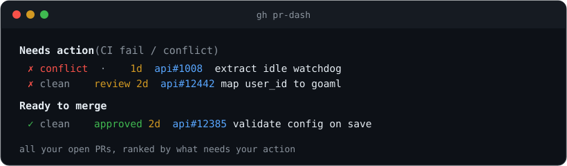

<div align="center">



<h1>gh pr-dash</h1>

<p><strong>All your open pull requests, across every repo, ranked by what needs your action.</strong></p>

<p>
  <a href="https://github.com/kobbikobb/gh-pr-dash/actions/workflows/ci.yml"></a>
  <a href="https://github.com/kobbikobb/gh-pr-dash/releases/latest"></a>
  
  
</p>

</div>

No LLM, no config, no state — deterministic, and ships as one precompiled binary.

On terminals 130+ columns wide a legend sidebar lists the status icons and per-category counts. Each category is a bordered panel with its icon, count and a one-line description. Each row: a **status** icon and label (e.g. `❌ CI failed`, `💥 Conflicts`, `🔧 Changes requested`, `🚦 Queued #2`, `✅ Ready`), **repo**, **idle** days (or the merge time for merged rows), and title (with comment count, and a 🤖 when Copilot has reviewed the PR). Press `o` to open the PR.

## Install

```bash
gh extension install kobbikobb/gh-pr-dash
```

Requires [`gh`](https://cli.github.com), authenticated (`gh auth login`) — the extension reuses gh's auth.

## Use

```bash
gh pr-dash                  # live dashboard, refreshes every minute
gh pr-dash --org my-org     # scope to one org/owner
gh pr-dash --interval 30s   # refresh interval
gh pr-dash 50               # cap at 50 PRs (default 100)
gh pr-dash --json           # print raw JSON rows once and exit (for scripts)
```

### Keys

A cursor (`❯`) marks the selected PR. Lowercase keys act on it; the capital version acts on every PR in its category.

| Key | Action |
|---|---|
| `↑` `↓` / `k` `j` | move the cursor |
| `1`–`7` | jump to a category (unfolds it if folded) |
| `/` | filter by title as you type (case-insensitive); `enter` keeps the filter |
| `enter` | fold / unfold the cursor's category |
| `o` / `O` | open the PR / the whole category in the browser (max 10 at once) |
| `m` / `M` | merge — only **ready** PRs; lists them and waits for `y` |
| `a` / `A` | send the PR / the whole category to an agent |
| `?` | show help |
| `esc` | clear the filter, then the status line or help |
| `q` | quit |

Refreshes pause while a merge is awaiting confirmation. The cursor follows its PR across refreshes.

Environment:

- `GH_PR_DASH_MERGE_FLAGS` — flags for `gh pr merge` (default `--squash`).
- `GH_PR_DASH_AGENT_CMD` — command to run with the PR list as its last argument (e.g. `claude -p`). The agent runs detached and its output is discarded. Unset, the list is copied to the clipboard instead. The status line says which happened.

## Ranking

Seven tiers, most-stale-first within each:

| Tier | Meaning |
|---|---|
| **Needs action** | merge queue rejected it, CI failing, merge conflict, changes requested, or unresolved review threads |
| **Ready to merge** | approved (no review still required), CI green, no conflicts, not blocked by GitHub |
| **In progress** | approved but CI still running, or in the merge queue |
| **Needs reviewer** | nobody asked to review or has reviewed (the author's own replies don't count) |
| **In review** | everything else that's open |
| **Drafts** | draft PRs |
| **Merged today** | merged since midnight (up to 10 listed, count shows the real total) |

Review status honors a standing approval or changes-request as well as `reviewDecision`, which is empty in repos that don't *require* review.

## Development

```bash
make test       # go test ./...
make lint       # gofmt check + go vet
make install    # build and install locally
make uninstall  # remove the local extension
```

Tagging `vX.Y.Z` builds cross-platform release binaries via [`cli/gh-extension-precompile`](https://github.com/cli/gh-extension-precompile).

## License

MIT
